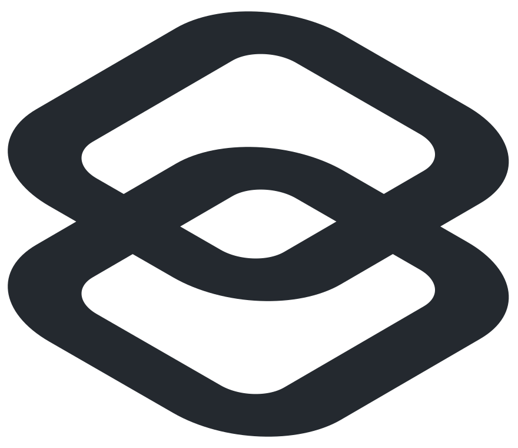
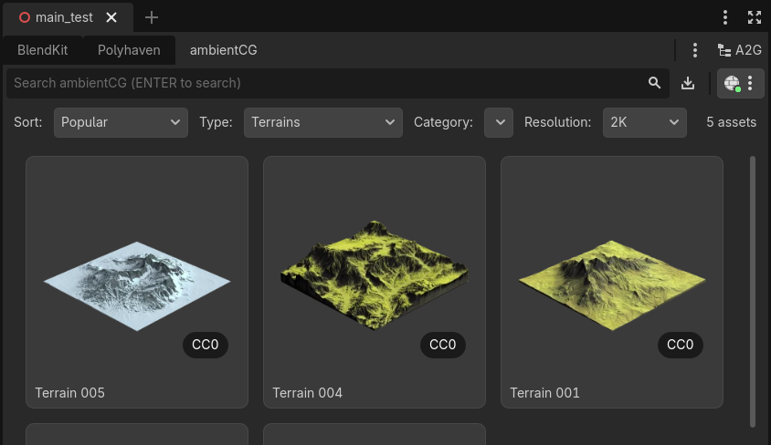

<div align="center">
  <h1 align="center"><picture>
    <source media="(prefers-color-scheme: dark)" srcset="img/a2g_logo.svg">
    
  </picture>&nbsp;A2G</h1>
  <p>
    <strong>Assets to Godot</strong> — a community asset browser and
    workspace for the Godot editor: browse, organize and import free CC0
    3D models, PBR materials, textures and HDRIs from
    <strong>BlendKit</strong>, <strong>Polyhaven</strong>,
    <strong>ambientCG</strong> and your own drives, without leaving the editor.
  </p>
  <p>
    <a href="https://github.com/ikonnow/Assets2Godot/releases/latest">
      
    </a>
    <a href="LICENSE">
      
    </a>
    <a href="https://ikonnow.itch.io/assets2godot">
      
    </a>
  </p>
  <p>
    
  </p>
</div>

---

## What it is

**Assets2Godot** is a free, open-source (GPLv2) Godot 4 editor plugin and
asset manager that turns the editor into an asset browser and staging
ground for multiple sources at once — free CC0 game assets (3D models,
PBR materials, textures, HDRIs) plus your own library:

- **BlendKit tab** — the full upstream Blendkit for Godot experience:
  search, filters, plans/login, downloads into `Assets2Godot/bk_assets/`
  (needs the bundled `bk_client` daemon).
- **Polyhaven + ambientCG tabs** — the public CC0 catalogs (models,
  materials, textures, HDRIs, brushes, decals, atlases) in pure
  GDScript — no account, no daemon.
- **Your own library** — a local index over external asset folders,
  project files and open-scene resources. Files stay where they are;
  staging into `res://imported_assets/<asset_name>/` is always explicit.
- **Drag & drop into the scene** — drop a provider card into the 3D
  viewport: models place at the hit point behind a live ghost preview,
  materials and textures assign to the mesh under the cursor, HDRIs
  apply to the WorldEnvironment and terrain/decal map-sets land as
  textured planes — every drop one undoable action. Dropping onto the
  FileSystem dock downloads into the project instead.
- Right-click any provider card for a compact **quick-download** tile
  (format picker + one-click download).

All provider downloads land under `res://Assets2Godot/<provider>/` — one
shared, gitignored parent next to your project files.

Status: **experimental (alpha)** — the core surfaces work; expect rough
edges. The **A2G** button overlays an organization surface (collections,
favorites, batch ops — see [Roadmap](#roadmap)).

## Requirements

- **Godot Engine 4** (4.4+; CI tests 4.4.1 and 4.7.x) — Windows, Linux,
  macOS (x86_64, arm64)
- **Recommended:** [Blender](https://www.blender.org/download/) for
  `.blend` assets and HDR/material conversion
- `bk_client` ships inside the full release ZIP; the `*_nobin.zip`
  variant downloads the pinned client on first run (the Godot-store
  variant). Only the BlendKit tab needs it.

## Installation

Download the ZIP from
[Releases](https://github.com/ikonnow/Assets2Godot/releases) or
[itch.io](https://ikonnow.itch.io/assets2godot), extract into your
project root, then **Project → Project Settings → Plugins → enable
Assets2Godot**. The workspace appears in the editor's top bar next to
**Asset Store**.

Upgrading: delete `addons/assets2godot/`, then install the new version.

## Building & development

Requires **Python 3**; **Go** only for `--from-source`.

```sh
git clone https://github.com/ikonnow/Assets2Godot.git
cd Assets2Godot
python dev.py build     # client binaries + plugin → out/assets2godot_vX.Y.Z.zip
python dev.py           # all commands (test, e2e, launch-status, ...)
```

The repo is itself a Godot project — open it in the editor to hack on
the plugin. Architecture notes and the provider-integration spec live in
[`docs/specs/`](docs/specs/); test suites are dev tooling and never ship.

## Roadmap

- **Organization overlay** — collections, favorites, multi-select and
  batch import across providers
- **More providers** — the provider contract is documented in
  [`docs/specs/remote-providers.md`](docs/specs/remote-providers.md)
- **Client signing** — signed `bk_client` binaries (today's unsigned
  builds trigger expected Gatekeeper/SmartScreen warnings)
- **Godot Asset Store** — submitted, currently under review

## Credits & License

Assets2Godot is Free and Open Source Software under **GPLv2**.

It is based on [Blendkit for Godot](https://github.com/BlenderKit/bk_godot)
by **Jakub Ruzicka** and **Andreas Gajdosik** (BlenderKit s.r.o.) — upstream
history, license and notices are preserved. The `bk_client` helper is a
fork of [BlenderKit/bk_client](https://github.com/BlenderKit/bk_client).
Provider logos: Poly Haven per their
[API terms](https://polyhaven.com/our-api), ambientCG per its brand
guide — see [`addons/assets2godot/logo/LICENSE`](addons/assets2godot/logo/LICENSE).

## Support

Assets2Godot is maintained in my spare time. If it saves you time, you can
support the work voluntarily via
[**ingmar.konnow.de/support**](https://ingmar.konnow.de/#/portal/support)
(Stripe, any amount — donations are appreciated, not required, and don't
entitle you to support or priority).

For bugs and feature requests, please use
[GitHub Issues](https://github.com/ikonnow/Assets2Godot/issues) — the
better the description, the easier the fix. For professional collaboration
(migrations, pipeline work, Unreal→Godot tooling), reach out via
[ingmar.konnow.de](https://ingmar.konnow.de) or `ingmar@konnow.de`.

Related project: **UE2Godot** — an Unreal Engine 5 → Godot 4 exporter
that keeps levels playable (lights, collision, volumes, audio arrive as
working Godot nodes, not a flat mesh dump).

## Contributing

Contributions are welcome — please open an
[issue](https://github.com/ikonnow/Assets2Godot/issues) first so we can
align on scope, then send a pull request against the `dev` branch.
